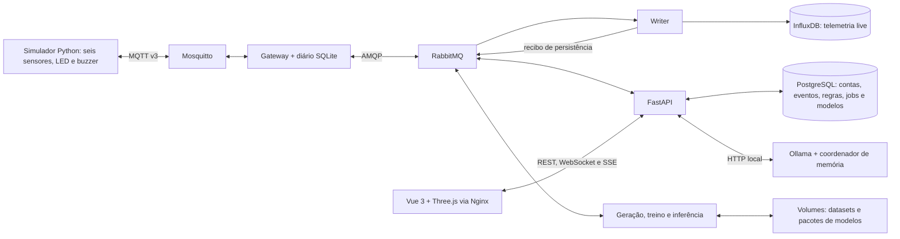

# ColdSafe

Protótipo acadêmico local de monitoramento de ambientes refrigerados e manutenção
preditiva de um ventilador simulado. A versão AIoT v3 integra seis sensores,
LED manual, buzzer por regra, mensageria, geração de dados, regressões de saúde e
vida útil restante (RUL), cena 3D e assistente com LLM local. Cada conta conserva
seus ambientes privados; papel administrativo não concede acesso aos de outra conta.

> O ColdSafe não é certificado para uso médico, sanitário ou regulatório.
> Medições, falhas, saúde e RUL são sintéticas, sem calibração em equipamento real.

## Arquitetura implementada



O writer publica recibo depois de gravar no InfluxDB; a API só libera a leitura
Web após correlacionar fonte e recibo. A recuperação HTTP v3 lê a projeção SQL.
Comandos exigem autorização e ACK da aplicação; a próxima telemetria comprova o
estado observado. Geração/treino são jobs persistentes, com progresso HTTP/SSE,
e ativação troca o pacote completo de saúde/RUL no worker de inferência.
O assistente consulta um resumo privado somente leitura, sem ferramentas de atuação.

Os [diagramas detalhados](docs/aiot/architecture.md) explicam esses fluxos e suas
falhas. Os [contratos](contracts/README.md) fixam formatos/unidades. ESP32/Wokwi e
MQTT v1/v2 continuam como caminho legado opcional, com [guia próprio](firmware/README.md).

## Instalação e comando único da pilha final

Use o checkout da branch `codex/block-5-validation` do
[repositório ColdSafe](https://github.com/VitorFcosta/ColdSafe). Os ensaios e a
revisão documental de 23/10/2026 partiram da base
`c6fa42d0314409610ab1dd4db14e4bfc9b55040f`; os commits de entrega posteriores
registram as mudanças B2-34/B2-35. Clonar somente essa base não inclui essas
mudanças. Antes da apresentação, identifique o commit efetivamente entregue
com `git rev-parse HEAD` e confira `git status --short`.

Pré-requisitos: Git, Python 3 para os scripts de configuração, Docker com Compose
v2 e porta `5173` livre. Node e as dependências Python da aplicação são instalados
nas imagens; só precisam estar no host para desenvolvimento/testes. O simulador
Python faz parte do Compose e dispensa Wokwi. Versões fixadas, incluindo Python
`3.13.15`, Node `24.20.0`, Vite `8.2.4`, Vitest `4.1.12` e Ollama `0.40.3`, estão
na [matriz de versões](docs/version-matrix.md), com os respectivos manifestos/locks.

Uma instalação nova exige **comissionamento antes da subida completa**. Siga o
[runbook](docs/runbook.md), nesta ordem:

1. Gere `.env` com `python3 scripts/generate-secrets.py`. O script preserva valores
   existentes e não imprime senhas. Inicialize somente o InfluxDB e provisione os
   tokens restritos pelo procedimento da seção 3.
2. Suba a base, crie sua conta, ambiente e dispositivo MQTT `sim-lab-01` em
   `/manage`. Promova o primeiro administrador pelo procedimento protegido do
   runbook; registro público começa como `operator`.
3. Crie o catálogo privado `simulator/local/catalog.json` a partir do exemplo,
   com os UUIDs reais do cadastro. Configure `GATEWAY_OWNER_USER_ID` e
   `WRITER_OWNER_USER_ID` para o mesmo proprietário. Confira o token do writer.
4. Defina a função abaixo na raiz do checkout e prepare os pesos, uma vez:

```sh
coldsafe() {
  docker compose -f compose.yaml -f compose.aiot.yaml -f compose.jobs.yaml \
    -f compose.inference.yaml -f compose.ollama.yaml \
    --profile aiot --profile simulator "$@"
}
coldsafe config --quiet
coldsafe stop llm ollama
coldsafe --profile llm-setup run --rm --no-deps ollama-prepare
```

O preparo requer internet e serviços LLM parados, sem jobs ativos. Os pesos
`llama3.2:3b-instruct-q4_K_M` ficam em volume; o runtime opera em rede interna.
Com o comissionamento e o download concluídos, **um comando sobe a pilha final**:

```sh
coldsafe up -d --build --wait --wait-timeout 300
```

A função conserva os cinco arquivos Compose e os dois perfis. `docker compose up`
sem essa composição sobe apenas a base. Confira `coldsafe ps -a`: são 14 serviços
contínuos saudáveis; inicializadores encerram com código zero. Não mostre
`docker compose config` sem `--quiet`, pois a saída resolvida contém segredos.

Abra a [aplicação](http://localhost:5173/) e a
[documentação REST](http://localhost:5173/docs). Confira `/health/live` e
`/health/ready` pela mesma porta. O percurso inclui Monitoramento (`/dashboard`),
Gêmeo Digital (`/digital-twin`), Insights (`/insights`), Assistente (`/assistant`),
Laboratório (`/laboratory`), Treinamento (`/training`) e Mensageria (`/messaging`).

Use a mesma função para `coldsafe down` e para subir novamente. **Preserve volumes**:
eles guardam bancos, diário, datasets, modelos e pesos. O estado físico/desgaste
do simulador reinicia com o processo; o histórico persistido permanece.

## Usuários de demonstração

São **nomes sugeridos a cadastrar localmente**, não contas ou credenciais
pré-instaladas. Guarde senhas fora do Git e da documentação.

| Conta sugerida | Papel | Demonstração |
| --- | --- | --- |
| `demo-admin@coldsafe.test` | `admin` | Proprietária do catálogo live; Laboratório, Treinamento, Mensageria e operações do próprio ambiente |
| `demo-operador@coldsafe.test` | `operator` | Cadastro, regras e comandos do próprio ambiente; páginas administrativas recusadas |
| `demo-leitura@coldsafe.test` | `viewer` | Consulta do próprio ambiente; escrita recusada |

Prepare ambientes privados para operador/leitura e atribua papéis com a API
administrativa indicada no runbook. O simulador provisionado pertence a uma única
conta; as outras podem mostrar ausência de leitura. Não reutilize UUIDs nem
credenciais do catálogo live entre contas. Não rebaixe o único administrador:
a API atual permite alterar o próprio papel e não protege o último admin.

## Demonstrar, verificar e retomar

O [roteiro final](docs/aiot/presentation.md) segue os 12 passos do professor:
infraestrutura, papéis, MQTT, REST, RabbitMQ, bancos, WebSocket, atuadores,
geração de ≥1 milhão, treino/ativação, falha/3D e LLM. Inclui comandos, evidências,
recuperação e perguntas. A previsão live exige modelo ativo e histórico causal
(padrão: uma hora); acelerar desgaste não acelera o relógio UTC desse histórico.
A falha aumenta a degradação gradualmente. Não prometa alerta instantâneo.

A [B2-34](docs/aiot/tasks/B2-34.md) e sua
[evidência datada](docs/evidence/b2-34.json) registram regressão e pilha real
aprovada no Mac conectado à tomada, sem OOM nas amostras. Quatro respostas SSE
levaram 35–67 s; treino ficou próximo do teto de 1 GiB. Houve falhas anteriores
preservadas. Esses resultados não são SLA nem ensaio final da apresentação.
A B2-36 ainda precisa executar esse ensaio na máquina e versão finais.

Para desenvolvimento, siga a instalação dos ambientes e as variáveis próprias
de integração no [runbook](docs/runbook.md). Com esses ambientes preparados:

```sh
.venv/bin/python -m pytest backend/tests
(cd frontend && npm run test:coverage && npm run build && npm run test:e2e)
```

O ensaio de stack é descartável e exige suas condições específicas; não aponte
os testes para volumes pessoais. Firmware tem validação separada no guia legado.
O [índice documental](docs/README.md) e o [guia AIoT](docs/aiot/README.md)
levam aos cartões e checkpoints.

## Autoria e estado da entrega

Em 23/10/2026, `git shortlog -sne HEAD` registra 74 commits sob o nome **vitor hugo**.
O usuário confirmou **vitor hugo como único integrante e responsável pelo projeto**.
O histórico Git registra a mesma autoria. Alterações locais não contam como
commits publicados.
Não foram fabricados commits, autores ou contribuições para satisfazer a rubrica.

Nenhuma conta de demonstração é criada por este documento. Segredos e catálogo
local continuam ignorados pelo Git. O acesso remoto/publicação não integra esta
entrega; configuração e limites estão no [guia de configuração](docs/configuration.md).
