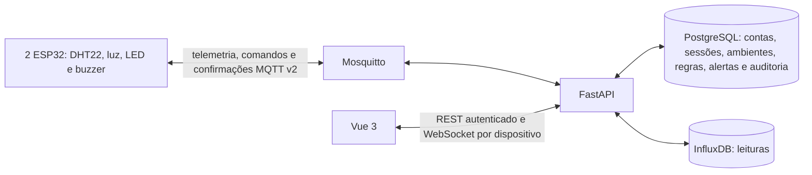

# ColdSafe

Protótipo acadêmico local de monitoramento de ambientes refrigerados. Cada conta
gerencia seus ambientes e dispositivos; dois ESP32 simulados medem temperatura,
umidade e luminosidade. O backend aciona o buzzer conforme os limites do ambiente,
e o usuário controla o LED pela interface, com confirmação do dispositivo.

> [!WARNING]
> O ColdSafe não é certificado para uso médico, sanitário ou regulatório e não
> substitui procedimentos oficiais de controle.

## Arquitetura



O backend valida as leituras antes de gravá-las no InfluxDB. A publicação de um
comando MQTT cria um estado pendente; somente a confirmação correlacionada do ESP32
permite exibir `confirmed`. Sem confirmação em 30 segundos, o comando fica
`unconfirmed`. O WebSocket entrega eventos do dispositivo autorizado; ao conectar
ou reconectar, a interface busca o estado atual por REST. Leituras antigas v1
continuam consultáveis com luminosidade `null`.

Os contratos versionados de MQTT, REST e eventos estão em [contracts/](contracts/README.md).

## Documentação e evolução AIoT

A documentação principal está em [docs/README.md](docs/README.md).
Para retomar a evolução, leia o [guia AIoT](docs/aiot/README.md) e apenas a
tarefa escolhida. Plano, requisitos, cartões e evidências foram consolidados
na pasta do projeto; o Notion conserva referências legadas.

O contrato AIoT v3 está definido; o runtime continua v1/v2.

## Executar localmente

Pré-requisitos: Git, Python 3 para gerar a configuração, Docker com Compose v2
e porta `5173` livre. Para os dois simuladores: VS Code, PlatformIO, Wokwi Simulator e licença
local válida.

```bash
git clone https://github.com/VitorFcosta/ColdSafe.git
cd ColdSafe
python3 scripts/generate-secrets.py
test -e firmware/include/secrets.h || cp firmware/include/secrets.example.h firmware/include/secrets.h
```

Configure as credenciais locais, incluindo as **duas senhas MQTT distintas** dos
dispositivos. Em uma instalação nova, crie o token restrito do InfluxDB antes de
subir a aplicação. Siga [docs/runbook.md](docs/runbook.md) para o procedimento
completo; [docs/configuration.md](docs/configuration.md) explica cada variável.

Depois do bootstrap:

```bash
docker compose config --quiet
docker compose up -d --build --wait --wait-timeout 180
docker compose ps -a
```

Abra [aplicação](http://localhost:5173/) e crie uma conta local. Em
`/dashboard`, selecione ou cadastre ambiente e dispositivo, ajuste os limites,
acompanhe sensores/alertas e solicite o LED. REST e WebSocket passam pelo proxy
do frontend; a documentação fica em [localhost:5173/docs](http://localhost:5173/docs).
Para Wokwi e portas locais de diagnóstico, habilite `compose.debug.yaml` conforme
o [runbook](docs/runbook.md), depois siga [firmware/README.md](firmware/README.md).

Para parar, use `docker compose down`. **Não use `--volumes`**: os volumes
guardam leituras, cadastros e configuração do broker.

## Validar

```bash
.venv/bin/python -m pytest backend/tests
cd frontend && npm run test:coverage && npm run build && npm run test:e2e
~/.platformio/penv/bin/pio run --project-dir ../firmware -e esp32dev -e esp32dev-02
```

O frontend usa Node `24.20.0` e o backend usa Python `3.13.15`; para instalar as
dependências de teste, veja [docs/runbook.md](docs/runbook.md). Os testes de
integração com bancos exigem os serviços e as variáveis próprias de teste.
Versões efetivas: [docs/version-matrix.md](docs/version-matrix.md).

O roteiro de apresentação e o registro do que foi comprovado estão em
[docs/testing/demo-rehearsal.md](docs/testing/demo-rehearsal.md). A página inicial
é uma apresentação; o uso operacional acontece em `/dashboard`.

## Segurança local

`.env` e `firmware/include/secrets.h` são arquivos locais ignorados pelo Git.
Sessões são revogáveis e expiram; REST e WebSocket verificam a propriedade do
dispositivo. O Mosquitto usa usuários e ACL separados por ESP32 e backend.
O acesso externo à internet não faz parte desta entrega.
