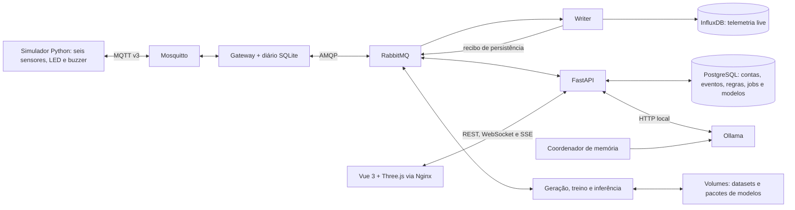

# ColdSafe

Protótipo acadêmico local de monitoramento de ambientes refrigerados e manutenção
preditiva de um ventilador simulado. A versão AIoT v3 integra seis sensores,
LED manual, buzzer por regra, mensageria, geração de dados, regressões de saúde e
vida útil restante (RUL), cena 3D e assistente com LLM local. Cada conta conserva
seus ambientes privados; papel administrativo não concede acesso aos de outra conta.

> O ColdSafe não é certificado para uso médico, sanitário ou regulatório.
> Medições, falhas, saúde e RUL são sintéticas, sem calibração em equipamento real.

## Arquitetura implementada



O writer publica recibo depois de gravar no InfluxDB; a API só libera a leitura
Web após correlacionar fonte e recibo. A recuperação HTTP v3 lê a projeção SQL.
Comandos exigem autorização e ACK da aplicação; a próxima telemetria comprova o
estado observado. Geração/treino são jobs persistentes, com progresso HTTP/SSE,
e ativação troca o pacote completo de saúde/RUL no worker de inferência.
O assistente consulta um resumo privado somente leitura, sem ferramentas de atuação.

Os [diagramas detalhados](docs/aiot/architecture.md) explicam esses fluxos e suas
falhas. Os [contratos](contracts/README.md) fixam formatos/unidades. ESP32/Wokwi e
MQTT v1/v2 continuam como caminho legado opcional, com [guia próprio](firmware/README.md).

## Como rodar

**Primeira instalação.** Abra o [runbook](docs/runbook.md#1-pré-requisitos) e siga
o comissionamento. Você vai gerar o `.env`, provisionar os tokens do InfluxDB,
subir a base, cadastrar a conta e o dispositivo `sim-lab-01`, vincular o catálogo
e preparar os pesos do assistente. Use Docker com Compose, Python 3 para os
scripts e a porta `5173` livre. No Windows, execute o guia pelo WSL 2.

**Instalação já comissionada.** Da raiz do projeto, use a composição padrão:

```sh
docker compose config --quiet
docker compose up -d --wait --wait-timeout 420
docker compose ps -a
```

O esperado são **14 serviços saudáveis** e **dois inicializadores com `Exited (0)`**.
Abra a [aplicação](http://localhost:5173/) e entre com a conta proprietária do
simulador. Em **Monitoramento → Visão geral**, selecione o ambiente de `sim-lab-01`
e confira se os seis sensores exibem leituras recentes. O Swagger está em
[`/docs`](http://localhost:5173/docs).

Acrescente `--build` ao `up` quando precisar reconstruir as imagens. Use
`docker compose down` para encerrar preservando os volumes. O [runbook](docs/runbook.md)
explica como distinguir indisponibilidade da API, telemetria ausente e previsão
em aquecimento. As versões estão na [matriz](docs/version-matrix.md).

## Usuários de demonstração

São **nomes sugeridos a cadastrar localmente**, não contas ou credenciais
pré-instaladas. Guarde senhas fora do Git e da documentação.

| Conta sugerida | Papel | Demonstração |
| --- | --- | --- |
| `demo-admin@coldsafe.test` | `admin` | Proprietária do catálogo live; Laboratório, Treinamento, Mensageria e operações do próprio ambiente |
| `demo-operador@coldsafe.test` | `operator` | Cadastro, regras e comandos do próprio ambiente; páginas administrativas recusadas |
| `demo-leitura@coldsafe.test` | `viewer` | Consulta do próprio ambiente; escrita recusada |

Prepare ambientes privados para operador/leitura e atribua papéis com a API
administrativa indicada no runbook. O simulador provisionado pertence a uma única
conta; as outras podem mostrar ausência de leitura. Não reutilize UUIDs nem
credenciais do catálogo live entre contas. Não rebaixe o único administrador:
a API atual permite alterar o próprio papel e não protege o último admin.

## Demonstrar, verificar e retomar

O [roteiro final](docs/aiot/presentation.md) segue os 12 passos do professor:
infraestrutura, papéis, MQTT, REST, RabbitMQ, bancos, WebSocket, atuadores,
geração de ≥1 milhão, treino/ativação, falha/3D e LLM. Inclui comandos, evidências,
recuperação e perguntas. A previsão live exige modelo ativo e histórico causal
(padrão: uma hora); acelerar desgaste não acelera o relógio UTC desse histórico.
A falha aumenta a degradação gradualmente. Não prometa alerta instantâneo.

A [evidência da B2-34](docs/evidence/b2-34.json) registra regressão e pilha real
aprovada no Mac conectado à tomada, sem OOM nas amostras. Quatro respostas SSE
levaram 35–67 s; treino ficou próximo do teto de 1 GiB. Houve falhas anteriores
preservadas. Esses resultados não são SLA nem ensaio final da apresentação.
A B2-36 foi encerrada em 25/10/2026 por aceite manual do usuário, incluindo
sua confirmação da correção do assistente. Os ensaios posteriores constam do
[roteiro da apresentação](docs/aiot/presentation.md).

Para desenvolvimento, instale o [ambiente Python](docs/configuration.md#instalar-as-dependências-de-teste)
e as [dependências do frontend e do Playwright](frontend/README.md#como-executar).
Na raiz, com Node `24.20.0` ativo:

```sh
.venv/bin/python -m pytest backend/tests
(cd frontend && npm run test:coverage && VITE_API_BASE_URL='' VITE_AIOT_ENABLED=true npm run build)
```

Depois do build, execute o [Playwright nos modos legado e v3](frontend/README.md#como-executar).
O ensaio de stack é descartável e exige suas condições específicas. Use
os ambientes de teste descritos nos guias.
O firmware tem validação separada no guia legado.
O [índice documental](docs/README.md) reúne os guias de instalação, operação,
arquitetura e demonstração.

## Autoria e estado da entrega

Em 23/10/2026, `git shortlog -sne HEAD` registra 74 commits sob o nome **vitor hugo**.
O usuário confirmou **vitor hugo como único integrante e responsável pelo projeto**.
O histórico Git registra a mesma autoria. Alterações locais não contam como
commits publicados.
Não foram fabricados commits, autores ou contribuições para satisfazer a rubrica.

Nenhuma conta de demonstração é criada por este documento. Segredos e catálogo
local continuam ignorados pelo Git. O acesso remoto/publicação não integra esta
entrega; configuração e limites estão no [guia de configuração](docs/configuration.md).
