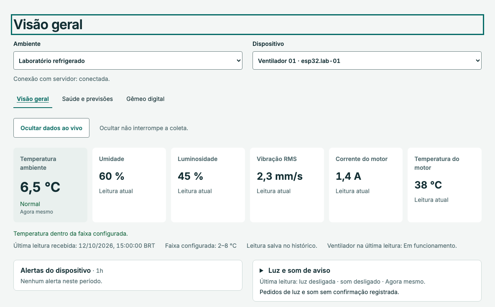
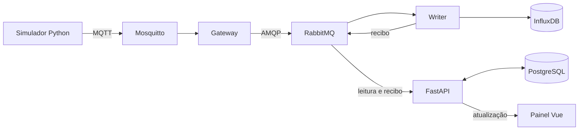

# ColdSafe

O ColdSafe é um protótipo acadêmico para monitorar um ambiente refrigerado
simulado, acompanhar alertas de temperatura e estimar a saúde e a vida útil
restante de um ventilador.

[Como rodar](#como-rodar) · [Arquitetura](#arquitetura-implementada) ·
[Documentação](docs/README.md)



*Visão geral do painel com dados simulados.*

- Acompanhe seis sensores em tempo real, consulte o histórico e inspecione o
  equipamento no gêmeo digital 3D.
- Controle a luz pelo painel e acompanhe o buzzer automático quando a
  temperatura sair da faixa configurada.
- Gere dados sintéticos, treine modelos de saúde e vida útil e consulte o
  estado do equipamento com o assistente local.

As medições e falhas são simuladas e servem para estudo. As estimativas de
saúde e vida útil carecem de calibração em equipamento real.

## Como rodar

### Primeira instalação

Tenha Git, Python 3, `curl` e Docker com Compose, com a porta local `5173`
livre. O primeiro build e o download dos pesos exigem internet. No Windows,
use WSL 2 com a integração do Docker Desktop. O build Docker já instala o Node
e as dependências da aplicação.

```sh
git clone --branch main https://github.com/VitorFcosta/ColdSafe.git
cd ColdSafe
```

1. Siga as [seções 2 a 5 do runbook](docs/runbook.md#2-criar-a-configuração-local)
   para gerar a configuração local, provisionar os tokens do InfluxDB e subir a
   base de cadastro.
2. Siga o [comissionamento da pilha completa](docs/runbook.md#pilha-final-aiot-jobs-inferência-e-assistente)
   para vincular `sim-lab-01` à sua conta, preparar o catálogo e os pesos do
   assistente e iniciar a aplicação.
3. Abra o [ColdSafe](http://localhost:5173/) e entre com a conta proprietária do
   simulador. Em **Monitoramento → Visão geral**, selecione o ambiente de
   `sim-lab-01` e confira se os seis sensores exibem leituras recentes.

### Iniciar uma instalação já preparada

Com conta, catálogo, tokens e pesos preparados, execute da raiz do projeto:

```sh
docker compose config --quiet
docker compose up -d --wait --wait-timeout 420
docker compose ps -a
```

O esperado são **14 serviços saudáveis** e **dois inicializadores com `Exited (0)`**.
O [runbook](docs/runbook.md) cobre diagnóstico e encerramento com os dados
preservados. Consulte a [matriz de versões](docs/version-matrix.md) para reproduzir
o ambiente e o [Swagger local](http://localhost:5173/docs) para explorar a API.

## Arquitetura implementada



O simulador publica uma leitura pelo MQTT. O gateway a encaminha ao RabbitMQ,
e o writer emite um recibo depois de gravá-la no InfluxDB. A API correlaciona
leitura e recibo antes de atualizar o painel. Quando o navegador reconecta,
a API recupera o estado pela projeção no PostgreSQL.

Veja os [fluxos de comandos, treinamento, inferência e assistente](docs/aiot/architecture.md)
e os [formatos das mensagens e da API](contracts/README.md). O percurso com
ESP32 e MQTT v1/v2 está no [guia de firmware](firmware/README.md).

## Usuários de demonstração

São **nomes sugeridos a cadastrar localmente**, não contas ou credenciais
pré-instaladas. Guarde senhas fora do Git e da documentação.

| Conta sugerida | Papel | Demonstração |
| --- | --- | --- |
| `demo-admin@coldsafe.test` | `admin` | Proprietária do catálogo live; Laboratório, Treinamento, Mensageria e operações do próprio ambiente |
| `demo-operador@coldsafe.test` | `operator` | Cadastro, regras e comandos do próprio ambiente; páginas administrativas recusadas |
| `demo-leitura@coldsafe.test` | `viewer` | Consulta do próprio ambiente; escrita recusada |

Cada conta acessa os próprios ambientes. Siga o
[runbook](docs/runbook.md#pilha-final-aiot-jobs-inferência-e-assistente) para
configurar os papéis e vincular o simulador à conta proprietária.

## Desenvolvimento e testes

Para desenvolvimento, instale o [ambiente Python](docs/configuration.md#instalar-as-dependências-de-teste)
e as [dependências do frontend e do Playwright](frontend/README.md#como-executar).
Na raiz, com Node `24.20.0` ativo:

```sh
.venv/bin/python -m pytest backend/tests
(cd frontend && npm run test:coverage && VITE_API_BASE_URL='' VITE_AIOT_ENABLED=true npm run build)
```

Depois do build, execute o [Playwright nos modos legado e v3](frontend/README.md#como-executar).
O ensaio de stack é descartável e exige suas condições específicas. Use
os ambientes de teste descritos nos guias.
O firmware tem validação separada no guia legado.
O [índice documental](docs/README.md) reúne os guias de instalação, operação e
arquitetura.
