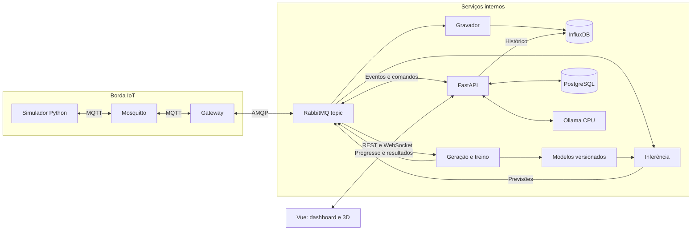
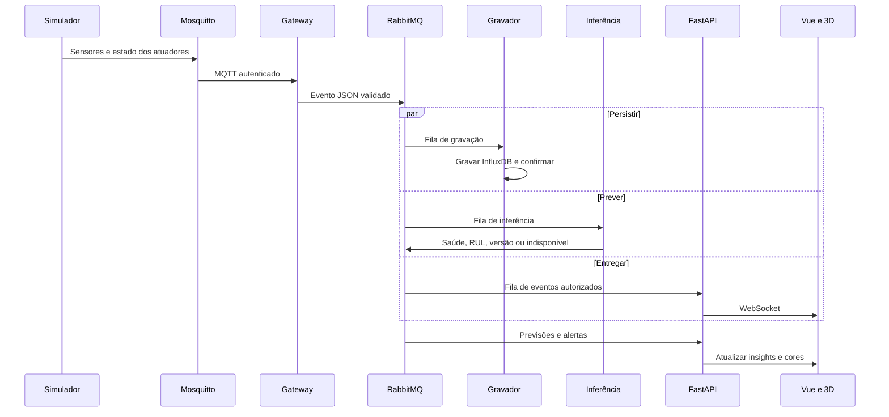
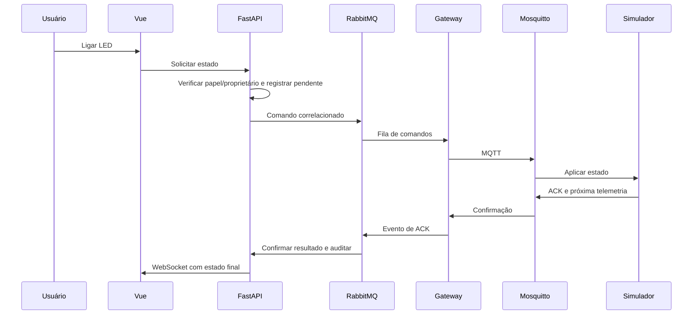
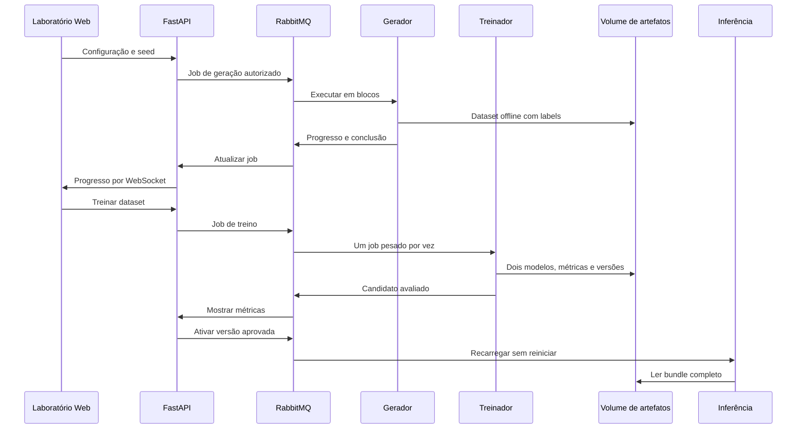

# Arquitetura alvo AIoT

**Arquitetura alvo, ainda não implementada.** Setas mostram protocolos e responsabilidades. Mosquitto é a borda IoT; RabbitMQ distribui eventos internos; REST consulta os bancos pela API.

B2-11 implementa o trecho simulador ↔ Mosquitto ↔ gateway ↔ RabbitMQ, incluindo
diário privado e validação de propriedade PostgreSQL. Os demais fluxos abaixo
continuam como alvo; o gravador, consumidores de negócio e API v3 são posteriores.

## Visão geral

## Telemetria e previsões

A entrega de telemetria e de previsão é assíncrona: a interface correlaciona equipamento e instante, sem atribuir previsão antiga a leitura nova. Sem modelo/histórico, mostra indisponibilidade. REST de histórico não contorna o RabbitMQ na ingestão.

O paralelismo do desenho representa responsabilidades, não autorização para
entregar uma leitura antes da persistência. A entrega Web segue a condição de
leitura validada e persistida definida no [contrato v3](../../contracts/aiot.md).
## Comando e confirmação

A automação do buzzer usa o mesmo caminho de comando, iniciada pela regra. Publicação não é confirmação de atuação. Repetir ID não deve aplicar o comando duas vezes.
## Geração, treino e ativação

## Fronteiras e revisão

- Navegador acessa somente ColdSafe; não acessa brokers, bancos ou Ollama diretamente.
- InfluxDB guarda telemetria. PostgreSQL guarda propriedade, regras, auditoria, jobs e metadados.
- Datasets e modelos em volumes separados; labels nunca trafegam na telemetria ao vivo.
- Filas duráveis, confirmações e DLQ; observabilidade não retira mensagens das filas de negócio.
- Um host é ponto único de falha nesta entrega acadêmica; testar recuperação, não acrescentar cluster.
- Ollama descarregado durante jobs pesados; dimensão dos blocos e concorrência condicionadas ao teste de 8 GB.
