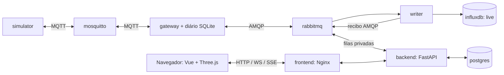
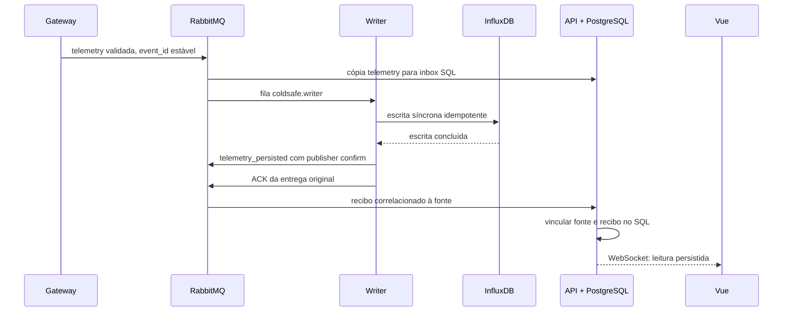
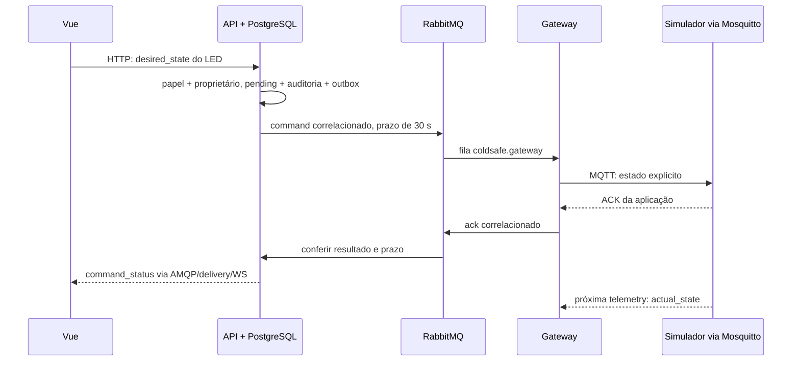
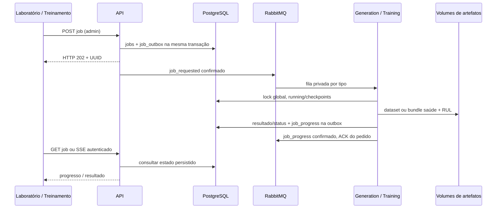
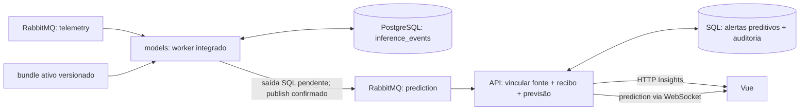
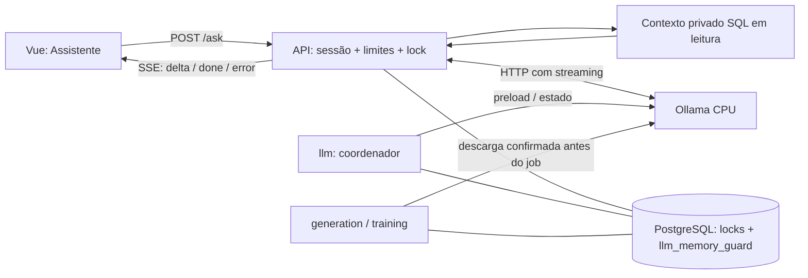

# Arquitetura AIoT implementada

**Atualizado em 23/10/2026 — B2-35.** Este mapa descreve o código v3 e os
serviços declarados no Compose. Não significa que a pilha pessoal foi iniciada
ou que a capacidade foi reavaliada nesta revisão documental. Formatos/unidades
continuam no [contrato v3](../../contracts/aiot.md); operação no
[runbook](../runbook.md) e resultados datados nos cartões/evidências.

## Serviços e fronteiras

A composição canônica usa cinco arquivos: [compose.yaml](../../compose.yaml) e
os overlays [AIoT](../../compose.aiot.yaml), [jobs](../../compose.jobs.yaml),
[inferência](../../compose.inference.yaml) e [Ollama](../../compose.ollama.yaml),
com os perfis `aiot` e `simulator`. O overlay AIoT já inclui observabilidade;
[compose.messaging.yaml](../../compose.messaging.yaml) é a alternativa mínima
para mensageria no caminho legado, sem ser um sexto arquivo obrigatório.
São **14 serviços contínuos**: `frontend`, `backend`, `postgres`, `influxdb`,
`mosquitto`, `rabbitmq`, `simulator`, `gateway`, `writer`, `generation`, `training`,
`models`, `ollama` e `llm`. Há três serviços de preparação fora dessa contagem:
`mosquitto-init` e `rabbitmq-init` inicializam os brokers; `ollama-prepare` prepara
os pesos separadamente, somente quando escolhido o perfil `llm-setup`.

O navegador acessa Nginx/API; bancos, brokers e Ollama não recebem conexões do
navegador. Nginx entrega o build estático Vue 3/TypeScript/Vite e faz proxy HTTP,
WebSocket e SSE. Node é ferramenta de build/desenvolvimento, não um servidor
contínuo adicional. A publicação padrão é em loopback; overlays de depuração
exigem escolha explícita. O backend conserva também o caminho MQTT v1/v2 legado,
isolado do consumidor AMQP v3.

Fontes: [proxy Nginx](../../frontend/nginx.conf),
[dependências frontend](../../frontend/package.json) e
[montagem do runtime](../../backend/app/runtime.py).

## Telemetria, recibo e entrega Web

O simulador publica seis sensores e estados observados de LED/buzzer por MQTT
QoS 1, sem `retain`. O gateway valida schema, identidade e propriedade atual no
PostgreSQL, fixa o primeiro `received_at` e grava no diário SQLite antes do ACK
MQTT. Depois publica em AMQP com confirmação e `mandatory`; uma reentrega conserva
a mesma identidade. O gravador revalida o escopo e grava `equipment_reading_v3`
no bucket `telemetry_live`, separado do histórico legado. Só publica o recibo
após a escrita e só confirma a entrega AMQP após confirmar esse recibo.

A API usa conexões/credenciais privadas para `coldsafe.commands` e
`coldsafe.delivery`, com inbox, projeção de eventos e outbox SQL. Seus efeitos
transacionais precedem o ACK. Fonte e recibo podem chegar em qualquer ordem:
a entrega Web da leitura exige ambos vinculados. A previsão também precisa de
fonte/recibo coerentes, versão autorizada e idade válida. `event_id` e
`source_event_id` evitam associar uma previsão antiga a uma leitura nova.

**Recuperação HTTP v3 consulta a projeção PostgreSQL** (`aiot_events`): resumo,
histórico, comandos e Insights são reconstruídos dali. O histórico informa
`persistence: pending/persisted`; não é uma consulta direta ao InfluxDB nem um
atalho de ingestão. O cliente aplica o estado de persistência ao apresentar a
leitura. O WebSocket é transitório, tem fila limitada e não reproduz toda a
história após desconexão; o cliente recupera estado por HTTP.

Fontes: [simulador](../../simulator/runtime.py),
[gateway/diário](../../gateway/bridge.py),
[transporte gateway](../../gateway/runtime.py), [writer](../../writer/runtime.py),
[consumidores API](../../backend/app/amqp/consumer.py),
[inbox/regras/outbox e recuperação](../../backend/app/services/aiot_events.py),
[rotas v3](../../backend/app/api/aiot.py),
[WebSocket/ticket](../../backend/app/api/events.py) e
[cliente de monitoramento](../../frontend/src/features/monitoring/aiot-api.ts).

## Comando, ACK e estado observado

`viewer` consulta sua própria conta; `operator`/`admin` podem comandar LED e
alterar regras autorizadas. O papel nunca substitui a verificação de dono e de
dispositivo ativo. A regra de temperatura inicia comandos do buzzer pela mesma
outbox/cadeia. O simulador recebe **estado desejado explícito**, não um toggle.

Publicar, receber publisher confirm ou receber PUBACK MQTT confirma transporte.
O status de negócio é `pending`, `confirmed`, `rejected` ou `unconfirmed`: a API
confere o ACK da aplicação, atuador, estado aplicado e janela de 30 s. ACK tardio
fica auditável. **ACK confirmado e estado observado são informações distintas**:
a próxima telemetria informa `actual_state`; a interface não inventa leitura a
partir do pedido. A deduplicação do simulador é em memória e se perde no restart;
não há promessa de atuação exatamente uma vez entre falhas.

Fontes: [comandos/ACK/timeout/regras](../../backend/app/services/aiot_events.py),
[autorização das rotas](../../backend/app/api/aiot.py),
[encaminhamento](../../gateway/runtime.py) e [atuação](../../simulator/runtime.py).

## Geração, treino e ativação

Os workers escrevem status e progresso diretamente no PostgreSQL. O evento
`job_progress` no barramento é uma saída durável, não a origem do estado HTTP.
A API consulta o banco a cada atualização SSE, revalida a sessão e termina no
estado terminal. A UI recupera o UUID e consulta HTTP; não depende de WebSocket
para acompanhar jobs. Os handlers de geração/treino são offline: labels ficam
nos datasets, nunca na telemetria live.

`generation` grava blocos determinísticos por seed em `job-artifacts`; `training`
lê esse volume e grava saúde/RUL, métricas, transformação e manifesto em
`training-artifacts`. Os dois alvos treinam em processos filhos sequenciais.
A API monta os volumes em leitura; `models` lê somente artefatos de treino.
Resultados só concluem após verificar registro, dono e artefato válido.

Ativação é outro pedido administrativo assíncrono: a API registra
`model_activations` + `model_outbox`; o worker consome a fila
`coldsafe.model-activation`. Valida e carrega o bundle completo antes de trocar
`active_models`. Ponteiro, status e outbox mudam na mesma transação SQL; falha
mantém o modelo anterior e um erro consultável. O overlay de inferência faz o
serviço **`models` executar ativação e inferência no mesmo worker**. O ativo é
reidratado no startup; a troca não exige reiniciar o navegador.

Fontes: [rotas HTTP/SSE](../../backend/app/api/jobs.py),
[estado/locks/outbox](../../backend/app/services/jobs.py),
[worker AMQP](../../backend/app/amqp/jobs.py),
[geração](../../backend/app/services/generation.py),
[treino](../../backend/app/services/training.py),
[ativação atômica](../../backend/app/services/models.py) e
[entrada do worker integrado](../../backend/app/inference_worker.py).

## Inferência e alertas

A inferência guarda fonte, histórico causal e previsão canônica em
`inference_events`, que também funciona como outbox até o publish confirmado.
Usa o mesmo kernel/transformação do treino, conserva a versão e retorna
indisponibilidade explícita (`no_model`, histórico insuficiente, entrada antiga,
modelo/features inválidos). O padrão de janelas é 900/3600 s: iniciar a pilha
não elimina o período necessário de histórico. A validade live é de 30 s.

Regras preditivas exigem fonte e recibo persistido; usam histerese inicial de
três entradas críticas para abrir e dez recuperadas para fechar. Ausência,
indisponibilidade, stale e troca de modelo interrompem sequências. **Alertas
preditivos ficam no SQL/auditoria e são consultados em `/api/v3/insights`**;
o serviço preditivo não publica um evento `alert` no AMQP. Alertas de temperatura,
status de comando e freshness usam `aiot_outbox` → RabbitMQ → delivery/WebSocket.

Fontes: [inferência causal e outbox](../../backend/app/services/inference.py),
[transporte integrado](../../backend/app/amqp/inference.py),
[kernel e janelas](../../backend/app/domain/features.py),
[alertas preditivos](../../backend/app/services/predictive_alerts.py) e
[alertas de temperatura](../../backend/app/services/aiot_events.py).

## Assistente local e coordenação de memória

O LLM recebe um resumo limitado aos dados da conta, montado por consulta SQL em
transação somente leitura. Não tem ferramentas nem acesso direto aos bancos,
MQTT ou AMQP e não executa comandos. A API ainda grava auditoria e coordenação:
“somente leitura” descreve o acesso a dados operacionais pelo assistente, não a
ausência de qualquer escrita administrativa. Perguntas têm até 256 bytes UTF-8,
cinco admissões/minuto/conta, cancelamento/timeout e revalidação da sessão no SSE.

O runtime atual usa `llama3.2:3b-instruct-q4_K_M`, CPU, contexto 1.024,
concorrência um; os pesos são preparados separadamente e montados em leitura,
com rede interna sem saída à internet. O serviço `llm` coordena preload, não é
quem responde HTTP ao navegador. Jobs pesados e geração de texto compartilham
`HEAVY_JOB_LOCK`; jobs aguardam descarga confirmada do Ollama. Preload usa ainda
`LOADING_LOCK`. O marcador durável `llm_memory_guard` impede admitir novo trabalho
quando há incerteza sobre carga/geração após perda da sessão SQL. Uma falha
ambígua pode exigir recuperação manual segura, descrita no runbook.

Fontes: [API SSE](../../backend/app/api/llm.py),
[contexto privado](../../backend/app/services/assistant_context.py),
[admissão/lease/auditoria](../../backend/app/services/assistant.py),
[transporte e timeout](../../backend/app/services/assistant_transport.py),
[coordenador/memória](../../backend/app/services/llm.py) e
[perfil Ollama](../../compose.ollama.yaml).

## Interface, recuperação e limites

As sete páginas do percurso AIoT são Monitoramento, Gêmeo Digital, Insights,
Assistente, Laboratório, Treinamento e Mensageria. Login, apresentação e cadastro
existem além delas. [Rotas Vue](../../frontend/src/router/index.ts) definem as
telas e a barreira de sessão; a autorização efetiva continua na API. O
[gêmeo Three.js](../../frontend/src/features/digital-twin/DigitalTwinScene.vue)
reutiliza os dados do monitoramento para seis sensores, dois atuadores (LED e
buzzer) e o equipamento ventilador, com seleção por teclado/lista, fallback sem WebGL e
movimento reduzido. Animação congela com dados antigos; posição e escala visual
são ilustrações locais, sem calibração física.

- **Parada/retomada:** consumidores respeitam sinais e reconectam; mensagens não
  confirmadas e outboxes persistentes permitem reentrega. Jobs mantêm checkpoints;
  geração pode repetir deterministicamente em diretório de tentativa separado,
  sem publicar dataset parcial como concluído. Parar container não é um botão
  de cancelamento de job na UI. Preservar volumes é condição de recuperação.
- **Locks:** exclusão global de geração/treino e LLM depende da sessão PostgreSQL
  viva, com marcador durável para o ciclo do LLM. Ativação tem lock por dono;
  inferência serializa por dono/dispositivo. Não são um coordenador distribuído
  independente do banco e não prometem exclusão perfeita após qualquer falha.
- **Mensageria:** credenciais/ACL por função, filas duráveis quorum, publisher
  confirms, tentativas limitadas e DLQ privada. Observabilidade usa cópia em fila
  própria e resumos privados; não consome originais das filas de negócio/DLQ.
  Polling `basic_get` pode mostrar zero assinaturas em `consumers` mesmo ativo.
- **Persistência:** InfluxDB live, SQL/projeções/jobs/modelos e artefatos têm
  responsabilidades diferentes. Não há transação distribuída entre eles; o
  transporte admite duplicatas. O diário gateway (~64 MiB) não tem expurgo;
  memória/cache do simulador não sobrevivem ao restart. Retenção/cardinalidade
  Influx e retenção das tabelas/artefatos precisam de gestão para uso prolongado.
- **Capacidade e validade:** host único, sem alta disponibilidade. Treino perto
  do teto de 1 GiB e LLM com margem pequena em 8 GB; tempos dependem da carga e do
  host. Dados/saúde/RUL são sintéticos, sem calibração física ou garantia clínica.
  Os ensaios [B2-33](../evidence/b2-33.json) e
  [B2-34](../evidence/b2-34.json) são evidência histórica com condições próprias,
  não SLA nem teste executado novamente nesta atualização.

Fontes adicionais: [topologia/limites/ACL](../../infra/rabbitmq/bootstrap.py),
[observador](../../backend/app/amqp/observation.py),
[diário gateway](../../gateway/bridge.py), [jobs](../../backend/app/services/jobs.py)
e [guia AIoT](README.md). Este arquivo não cria dependências nem altera execução.
