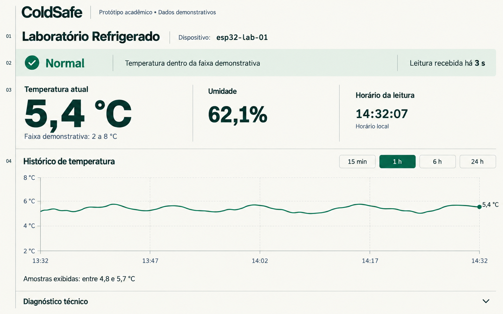
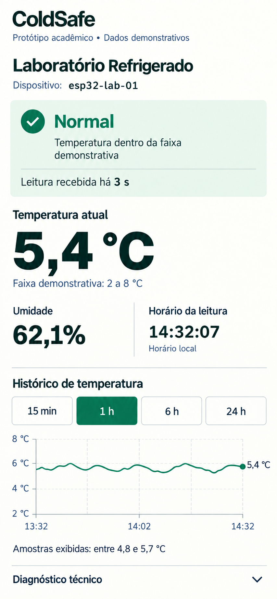
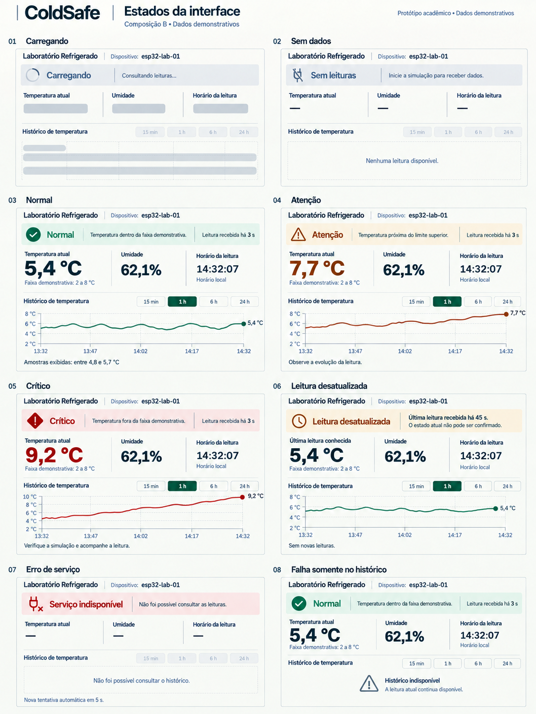

# CS-26 — Executar e aprovar composição Impeccable

- **Status:** Concluída
- **Dependências:** Registrar PRODUCT.md do frontend
- **Frente / prioridade:** Frontend / P0

## Aceite

Uma direção e composições desktop/mobile são aprovadas antes do código visual.

## Aprovação final — 09/09/2026

**Aprovado pelo autor do projeto:** direção Caderno de bancada, composição B — Gráfico ampliado, desktop, mobile e os oito estados da interface.
O critério de aceite da CS-26 foi atendido antes da implementação visual.

## Decisões

- Estado e atualidade agrupados; temperatura dominante, umidade secundária e horário terciário.
- Desktop com métricas em linha e gráfico amplo abaixo. Mobile em uma coluna, sem numeração lateral.
- Faixa normal em verde, atenção em âmbar e criticidade em vermelho; sempre com texto e ícone.
- Leitura desatualizada identificada como última leitura conhecida, sem confirmar o estado atual.
- Falha somente no histórico preserva a leitura atual válida. Falha de consulta e ausência de dados são estados distintos.
- Resumo do gráfico se refere às amostras exibidas; escala abrange as leituras sem extrapolar a última amostra.

## Referências aprovadas

### Desktop — referência 1440 × 900

### Mobile — referência 390 × 844

### Oito estados da interface

## Documento de direção visual

Conteúdo completo preparado para o autor criar `frontend/DESIGN.md` localmente. O documento inclui paleta, organização, estados, regras do histórico e critérios de acessibilidade.
[design-2026-09.md](../design-2026-09.md)

## Validação e limites

- Inspeção visual de desktop, mobile e estados; revisão de hierarquia e mensagens.
- Pares de contraste amostrados: texto principal/fundo 12,02:1; texto normal/faixa 10,27:1; texto branco/controle selecionado 5,45:1.
- As imagens são mockups, não uma implementação funcional. Teclado, dimensões CSS, responsividade e contraste completo serão validados na implementação.
- Nenhuma dependência de aplicação foi adicionada.

## Continuidade

A próxima tarefa é [CS-27](CS-27.md).
Os arquivos de trabalho `.impeccable/` permanecem locais e ignorados pelo Git; as três imagens finais estão preservadas nos anexos acima.

## Registro Git

Commit local: `3abc5c2b039ef90c161d9923d0be2233ac6ab936`.
Mensagem: `docs(frontend): registra aprovação visual da CS-26`.
Arquivos: `.gitignore`, `frontend/PRODUCT.md` e `frontend/README.md`.
O commit registra o produto, a aprovação visual e a localização das evidências. Não houve push.
Validação: revisão do diff preparado e `git diff --cached --check` sem erros. A tentativa de executar `pip_audit` não pôde prosseguir porque o módulo não está instalado no ambiente; o commit não altera código de aplicação ou dependências.
